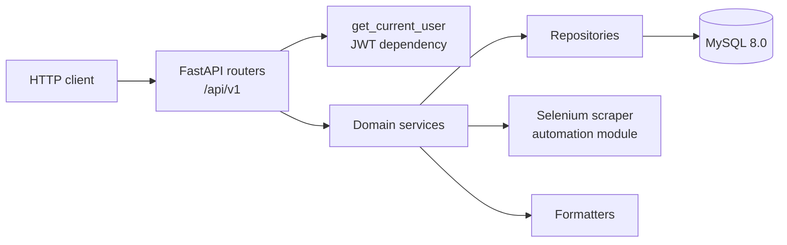

<div align="center">

# FastAPI Boilerplate ⚡

**A compact FastAPI starter with a domain-oriented layout, SQLAlchemy persistence, JWT authentication, and a Selenium-based user generator.**

[](https://www.python.org/)
[](https://fastapi.tiangolo.com/)
[](https://www.sqlalchemy.org/)
[](https://www.mysql.com/)
[](https://www.selenium.dev/)
[](#overview)
[](#license)

<br />

<p align="center">
  <a href="#overview"><b>Overview</b></a> •
  <a href="#stack"><b>Stack</b></a> •
  <a href="#architecture"><b>Architecture</b></a> •
  <a href="#quick-start"><b>Quick Start</b></a> •
  <a href="#configuration"><b>Configuration</b></a> •
  <a href="#api-surface"><b>API</b></a> •
  <a href="#testing"><b>Testing</b></a> •
  <a href="#deployment"><b>Deployment</b></a> •
  <a href="#known-limitations"><b>Limitations</b></a> •
  <a href="#governance"><b>Governance</b></a>
</p>

</div>

---

> **Repository:** [felipevenas/api-boilerplate](https://github.com/felipevenas/api-boilerplate) ·
> **Default branch:** `master` (not `main`) ·
> **Interactive API docs:** `http://localhost:8000/docs` after starting the app

## Overview

`api-boilerplate` is a teaching-oriented **FastAPI template**. It shows a readable, domain-oriented way to structure a Python API: HTTP routes stay thin, services own business rules, repositories own persistence, and Pydantic v2 schemas validate the boundary.

The repository covers four concerns:

| Area | What is implemented |
|---|---|
| Authentication | Registration, username/password login through the OAuth2 password form, HS256 JWT access tokens, and a `get_current_user` dependency |
| Users | Create, list, read, update, delete, look up by e-mail or username, and toggle `active` |
| Automation | An authenticated endpoint that scrapes fake identity data with Selenium and persists it as a user |
| Platform | Swagger UI and ReDoc, standard response helpers, daily rotating logs, and Docker Compose for MySQL 8.0 plus phpMyAdmin |

> **This is a boilerplate, not a production service.** It has no automated tests, CI pipeline, database migrations, container image, rate limiting, or license file. Read [Known Limitations](#known-limitations) before reusing it. The code is intentionally small so the structure is easy to study and extend.

### Who this is for

- Developers starting a new FastAPI project who want a concrete layering reference.
- Students comparing DDD-oriented folder organization with a classic layered API.
- Teams looking for a starting point that they will harden before production.

### What this repository owns

Only the Python API. MySQL and phpMyAdmin are provisioned locally by `docker-compose.yml`; there is no frontend, no worker, and no deployment automation in this repository.

## Stack

Versions below were verified against [`requeriments.txt`](requeriments.txt) and the source imports. There is no lockfile, `pyproject.toml`, or `setup.py`, so the text file is the only dependency manifest.

| Technology | Version | Role |
|---|---|---|
| Python | 3.10+ | Minimum required by the `list[...]` and `X \| None` syntax used in the source. A `pyproject.toml` declaring this is not present. |
| FastAPI | 0.128.0 | HTTP framework, dependency injection, OpenAPI generation |
| Starlette | 0.50.0 | ASGI foundation used by FastAPI |
| Uvicorn | 0.40.0 | ASGI server |
| Pydantic | 2.12.5 | Request/response validation |
| pydantic-settings | 2.12.0 | Environment-backed settings |
| SQLAlchemy | 2.0.46 | ORM and session management |
| PyMySQL | 1.1.2 | MySQL driver used by the `mysql+pymysql` URL |
| python-jose | 3.5.0 | JWT encoding and decoding |
| Passlib + bcrypt | 1.7.4 / 4.0.1 | Password hashing |
| python-dotenv | 1.2.1 | `.env` loading |
| python-multipart | 0.0.20 | Form parsing for the OAuth2 password login |
| Selenium | 4.16.0 | Browser automation for the scraper |
| undetected-chromedriver | 3.5.5 | Chromedriver wrapper used by the scraper |
| MySQL | 8.0 | Database image in `docker-compose.yml` |
| Docker Compose | v2 syntax | Local MySQL and phpMyAdmin only |

> The previous documentation claimed `asyncmy`, Selenium `4.40.0`, and `DB_PASSWORD`. Those do not match the repository. The actual driver is **PyMySQL**, the actual Selenium pin is **4.16.0**, and the actual variable is **`DB_PASS`**.

## Architecture

```text
api-boilerplate/
├── app/
│   ├── main.py                       # FastAPI app, OpenAPI metadata, root route
│   ├── api/
│   │   ├── auth/
│   │   │   └── dependencies.py       # OAuth2 bearer scheme and get_current_user
│   │   └── endpoints/
│   │       └── routes.py             # Aggregates domain routers under /api/v1
│   ├── core/
│   │   ├── auth.py                   # Password hashing and JWT helpers
│   │   ├── config.py                 # Pydantic settings loaded from .env
│   │   └── response.py               # success_response / error_response helpers
│   ├── db/
│   │   ├── base_class.py             # SQLAlchemy declarative Base
│   │   └── session.py                # Engine, SessionLocal, get_db
│   ├── domain/
│   │   ├── auth/
│   │   │   ├── routes.py             # /register, /login, /me
│   │   │   └── schemas.py            # RegisterRequest, TokenResponse
│   │   ├── automation/
│   │   │   ├── routes.py             # /automations/scraper/generate-user
│   │   │   └── services.py           # AutomationService
│   │   └── user/
│   │       ├── models.py             # SQLAlchemy User model
│   │       ├── repository.py         # UserRepository
│   │       ├── routes.py             # User CRUD and lookups
│   │       ├── schemas.py            # UserCreate, UserRead, UserUpdate
│   │       └── services.py           # UserService
│   ├── helpers/
│   │   ├── birth_formatter.py        # DD/MM/YYYY -> date
│   │   └── phone_formatter.py        # Digits -> (XX) XXXXX-XXXX
│   └── infra/
│       ├── logging/
│       │   └── logger.py             # Daily rotating file + console logger
│       └── scrapers/
│           └── generate_user.py      # Selenium/undetected-chromedriver scraper
├── docker-compose.yml                # MySQL 8.0 + phpMyAdmin
├── requeriments.txt                  # Pinned dependencies (filename misspelled)
├── README.md
└── .gitignore
```

### Request flow



### Layer responsibilities

| Layer | Location | Responsibility | Should not |
|---|---|---|---|
| Routes | `app/domain/*/routes.py` | Parse HTTP input, declare status codes, call services, shape responses | Contain SQL or business rules |
| Schemas | `app/domain/*/schemas.py` | Validate and serialize payloads with Pydantic | Touch the database |
| Services | `app/domain/*/services.py` | Business rules and orchestration | Build HTTP responses or import FastAPI |
| Repositories | `app/domain/user/repository.py` | SQLAlchemy queries and commits | Validate HTTP payloads |
| Models | `app/domain/user/models.py` | Table mapping | Know about routes or schemas |
| Core | `app/core/` | Settings, JWT/password helpers, response envelopes | Know about a specific domain |
| Infrastructure | `app/infra/` | Logging and browser automation | Be imported by routes directly |

### Design notes

- The structure is **domain-oriented** and inspired by Clean Architecture and DDD, but it is **not** a strict ports-and-adapters implementation. Routes instantiate concrete services, and `UserService` depends on the concrete `UserRepository`. There are no interfaces or dependency-inversion containers.
- Dependency injection uses FastAPI's `Depends`. Each domain exposes a factory such as `get_user_service(db)` that wires `UserRepository` into the service.
- Persistence is synchronous SQLAlchemy 2.0. Route handlers are declared with `def`, so FastAPI runs them in its thread pool. The project does **not** use async SQLAlchemy or `async def` handlers.
- All API routers are mounted under `/api/v1` in `app/main.py`.
- OpenAPI metadata (`title`, description, contact, tags, version `1.0.0`) is defined inline in `app/main.py`. The descriptions are currently in Portuguese.

## Quick Start

### Prerequisites

- **Python 3.10+** with `pip`.
- **Docker Desktop** (or any Docker Engine with Compose v2) for MySQL and phpMyAdmin.
- **Google Chrome 144** if you intend to call the scraper endpoint. `generate_user.py` hardcodes `version_main=144`.
- **Git**.

### 1. Clone the repository

```powershell
git clone https://github.com/felipevenas/api-boilerplate.git
cd api-boilerplate
```

### 2. Create and activate a virtual environment

Windows (PowerShell):

```powershell
python -m venv .venv
.\.venv\Scripts\Activate.ps1
python -m pip install --upgrade pip
```

Linux/macOS:

```bash
python3 -m venv .venv
source .venv/bin/activate
python -m pip install --upgrade pip
```

### 3. Install dependencies

```bash
pip install -r requeriments.txt
```

> The file name is intentionally documented as **`requeriments.txt`** because that is what the repository contains. Do not rename it in a documentation-only change; see [Known Limitations](#known-limitations).

### 4. Create the `.env` file

Create `.env` at the repository root (next to `docker-compose.yml`):

```env
DB_USER=root
DB_PASS=change-me
DB_HOST=127.0.0.1
DB_PORT=3306
DB_NAME=api_boilerplate

SECRET_KEY=replace-with-a-long-random-value
ACESS_TOKEN_EXPIRE_MINUTES=60
ALGORITHM=HS256
```

`DB_HOST` must be reachable from the process running Uvicorn. Use `127.0.0.1` when the API runs on the host and MySQL runs in Docker. `.env` is ignored by Git and must never be committed.

### 5. Start MySQL and phpMyAdmin

```bash
docker compose up -d
```

| Service | URL / port | Credentials |
|---|---|---|
| MySQL | `localhost:${DB_PORT}` (default example: `3306`) | `root` / value of `DB_PASS` |
| phpMyAdmin | `http://localhost:8080` | `root` / value of `DB_PASS` |

Check status with `docker compose ps`. Stop with `docker compose down`; add `-v` to delete the database volume.

### 6. Create the `users` table

The application does **not** create tables and there is **no migration tool** (no Alembic, no `Base.metadata.create_all`). Create the schema manually before exercising the user endpoints. The reference DDL below is derived from `app/domain/user/models.py`:

```sql
CREATE TABLE IF NOT EXISTS users (
    id INT NOT NULL AUTO_INCREMENT,
    name VARCHAR(60) NOT NULL,
    email VARCHAR(60) NOT NULL,
    username VARCHAR(60) NOT NULL,
    password VARCHAR(255) NOT NULL,
    phone VARCHAR(15) NOT NULL,
    birth DATE NOT NULL,
    active BOOLEAN NOT NULL DEFAULT TRUE,
    created_at DATETIME NOT NULL,
    updated_at DATETIME NOT NULL,
    PRIMARY KEY (id)
) ENGINE=InnoDB DEFAULT CHARSET=utf8mb4;
```

You can run it in phpMyAdmin or with `docker compose exec mysql mysql -uroot -p"$DB_PASS" "$DB_NAME"`. A dedicated database user and migrations are recommended follow-ups.

### 7. Start the API

```bash
uvicorn app.main:app --reload
```

The API starts at **http://localhost:8000**.

| Endpoint | URL |
|---|---|
| Root health-style message | `GET http://localhost:8000/` |
| Swagger UI | `http://localhost:8000/docs` |
| ReDoc | `http://localhost:8000/redoc` |
| OpenAPI JSON | `http://localhost:8000/openapi.json` |

Smoke test:

```powershell
curl.exe http://localhost:8000/
```

### 8. Authenticate and call a protected route

Register a user, then log in with the **username** (not the e-mail):

```bash
curl -X POST http://localhost:8000/api/v1/register \
  -H "Content-Type: application/json" \
  -d '{"name":"Ada Lovelace","email":"ada@example.com","username":"ada","password":"change-me","phone":"11987654321","birth":"1990-03-15"}'

curl -X POST http://localhost:8000/api/v1/login \
  -H "Content-Type: application/x-www-form-urlencoded" \
  -d "username=ada&password=change-me"
```

Copy `access_token` from the login response and send it as `Authorization: Bearer <token>` on protected routes.

## Configuration

Settings are defined in `app/core/config.py`, loaded from `.env` at the repository root, and cached with `lru_cache`. Restart the process after changing any value. There is no `.env.example`; the table below is the reference.

### Application and security

| Variable | Required | Example | Description |
|---|---|---|---|
| `SECRET_KEY` | **Yes** | `replace-with-a-long-random-value` | HMAC key used to sign and verify JWTs. Use a long random value and never commit it. |
| `ACESS_TOKEN_EXPIRE_MINUTES` | **Yes** | `60` | Access-token lifetime in minutes. The variable name is misspelled in the source; keep the typo until a coordinated code change. |
| `ALGORITHM` | **Yes** | `HS256` | JWT signing algorithm passed to python-jose. |

### Database

| Variable | Required | Example | Description |
|---|---|---|---|
| `DB_USER` | **Yes** | `root` | MySQL user. |
| `DB_PASS` | **Yes** | `change-me` | MySQL password. Also used by Docker Compose as `MYSQL_ROOT_PASSWORD`. |
| `DB_HOST` | **Yes** | `127.0.0.1` | MySQL host. Use the service name only when the API itself runs inside the Compose network. |
| `DB_PORT` | **Yes** | `3306` | MySQL port. Also used by Docker Compose as the published host port. |
| `DB_NAME` | **Yes** | `api_boilerplate` | Database name. Also used by Docker Compose as `MYSQL_DATABASE`. |

The connection URL is assembled as:

```text
mysql+pymysql://{DB_USER}:{DB_PASS}@{DB_HOST}:{DB_PORT}/{DB_NAME}
```

**Notes**

- All eight variables are effectively required: the settings fields have no usable defaults, and a missing value fails validation at startup.
- `DB_PASS` is interpolated into the URL verbatim. Characters such as `@`, `:`, `/`, or `#` can break the URL; use an alphanumeric password or URL-encode it. Adding proper URL encoding is a recommended fix.
- Docker Compose reads `DB_PORT`, `DB_PASS`, and `DB_NAME` from the same `.env` file. It does not start the API.
- `MYSQL_ALLOW_EMPTY_PASSWORD: "yes"` is present alongside `MYSQL_ROOT_PASSWORD`. Do not expose this database outside local development.

## API Surface

All application routes are mounted under `/api/v1` except the root and the documentation endpoints. Authentication uses the OAuth2 password flow with a JWT bearer token. The OpenAPI title is `Projeto - API Introduction`, version `1.0.0`.

### Routes

| Method | Path | Auth | Description |
|---|---|---|---|
| `GET` | `/` | Public | Health-style message returned by `app/main.py`. |
| `POST` | `/api/v1/register` | Public | Creates a user from `RegisterRequest`. Returns `201` with a `UserRead` object. Rejects a duplicate e-mail with `409`. |
| `POST` | `/api/v1/login` | Public | OAuth2 password form (`username`, `password`). Returns `access_token` and `token_type`. Inactive users are rejected with `401`. |
| `GET` | `/api/v1/me` | Bearer | Returns the authenticated `User` ORM object. See the security note below. |
| `GET` | `/api/v1/users` | Bearer | Lists active users (the repository filters `active == True`). |
| `POST` | `/api/v1/` | Bearer | Creates a user from `UserCreate`. Note the path: router root, not `/users`. The password is stored without hashing on this path. |
| `GET` | `/api/v1/users/{id}` | Bearer | Returns one user by numeric ID. |
| `PUT` | `/api/v1/users/{id}` | Bearer | Updates name, e-mail, phone, birth, and active status. |
| `DELETE` | `/api/v1/users/{id}` | Bearer | Deletes a user by ID. |
| `GET` | `/api/v1/users/by-email/{email}` | Bearer | Looks up a user by e-mail. |
| `GET` | `/api/v1/users/by-username/{username}` | Bearer | Looks up a user by username. |
| `PUT` | `/api/v1/users/active/{id}` | Bearer | Toggles the `active` flag. |
| `POST` | `/api/v1/automations/scraper/generate-user` | Bearer | Runs the Selenium scraper, formats the data, hashes the password, and persists a user. Returns `201`. |
| `GET` | `/docs` | Public | Swagger UI. |
| `GET` | `/redoc` | Public | ReDoc. |
| `GET` | `/openapi.json` | Public | OpenAPI schema. |

### Authentication details

- `app/core/auth.py` signs a payload containing only `sub` (the user ID as a string) and `exp`.
- `app/api/auth/dependencies.py` decodes the token, converts `sub` to an integer, loads the user, and returns it. Any decoding or subject-parsing failure becomes `401`; database errors propagate.
- The bearer scheme declares `tokenUrl="/api/v1/login"`.
- There is no refresh token, token revocation list, audience claim, issuer claim, or key rotation.

### Response formats

The user and automation routers use the helpers in `app/core/response.py`:

```json
{
  "status": "success",
  "message": "Usuarios retornados com sucesso!",
  "data": {}
}
```

```json
{
  "status": "error",
  "message": "Ocorreu um erro!",
  "details": null
}
```

The format is **not uniform across the API**:

- Auth routes return bare Pydantic models (`UserRead`, `TokenResponse`).
- `HTTPException` and request-validation failures return FastAPI's default `{"detail": ...}` / `{"detail": [...]}` shape.
- Several not-found and failure branches return **HTTP 200** with `status: "error"` instead of a 4xx status.

Runtime message strings and OpenAPI descriptions are currently in Portuguese. Translating them changes the API contract and source code, so it is intentionally out of scope for this documentation pass.

## Testing

**There is no automated test suite in this repository.** No `tests/` directory, `pytest` dependency, test configuration, coverage tool, linter, type checker, or CI workflow is present. Do not claim test coverage for this template.

Until a suite exists, validate changes manually:

| Check | Command / action |
|---|---|
| Syntax | `python -m compileall app` |
| Import and startup | `uvicorn app.main:app --reload` with a valid `.env` and reachable MySQL |
| OpenAPI generation | Open `http://localhost:8000/openapi.json` |
| Authentication | Register, log in, and call `GET /api/v1/me` with the bearer token |
| User CRUD | Exercise list, create, read, update, delete, and the two lookup routes |
| Error paths | Call with a missing token, a malformed token, a duplicate e-mail, and an unknown ID |
| Automation | Call the scraper route only with Chrome 144 installed and only in a local environment |

Recommended follow-ups: add `pytest` + `httpx`, isolate the database with Testcontainers or a disposable MySQL service, add `ruff` and a type checker, and run the gates in GitHub Actions.

## Deployment

This repository contains **no production deployment artifacts**:

- No `Dockerfile` and no API service in `docker-compose.yml`.
- No CI/CD workflow, reverse proxy, TLS configuration, or process manager.
- No migrations, backup strategy, observability stack, or secret manager.
- `uvicorn app.main:app --reload` is a development command only.

`docker-compose.yml` provisions **local infrastructure only**: MySQL 8.0 and phpMyAdmin. It does not build, run, or scale the API.

A real deployment would need, at minimum: a pinned Python image, a non-root runtime user, a production ASGI server configuration, managed MySQL with backups, a migration tool, secrets injected at runtime, CORS for the actual frontend origin, HTTPS, request limits, structured logs, health checks, and monitoring. Treat all of that as project-specific work, not as something this boilerplate already provides.

## Known Limitations

This section is deliberately explicit. These are current properties of the code, not hidden behavior.

### Template status

- `api-boilerplate` is a learning/reference template, not a production service.
- There is **no `LICENSE` file**. Copyright and reuse rights are therefore undefined. Add a license before distributing the project or accepting external contributions.
- No versioned releases, changelog history, or support policy existed before this documentation baseline.

### Security and authorization

- **`GET /api/v1/me` returns the SQLAlchemy `User` object directly, including the `password` hash.** This is the most important issue to fix before any real use. Other user routes return `UserRead`, which excludes the hash.
- Every authenticated user can read, update, delete, activate, or deactivate **any** user. There are no roles, ownership checks, or admin scopes.
- There is no CORS middleware. Browser clients served from another origin cannot call the API without a proxy.
- There is no rate limiting, account lockout, password policy, e-mail verification, or CAPTCHA.
- JWTs contain only `sub` and `exp`; there is no refresh flow, revocation, issuer/audience validation, or key rotation.
- `get_current_user` does not reject inactive users. A token issued before deactivation remains valid until it expires.
- Business failures sometimes return HTTP `200` with `status: "error"`, which breaks client error handling and monitoring.
- There are no unique constraints on `email` or `username`. Registration checks only for a duplicate e-mail, and concurrent requests can still race.
- **The direct `POST /api/v1/` creation route stores `UserCreate.password` without hashing it.** Only `/api/v1/register` and `AutomationService` hash passwords before calling the repository. Users created through the router root therefore have plaintext passwords and cannot authenticate through `/login`.
- Passwords are hashed with bcrypt through Passlib. `passlib==1.7.4` and `bcrypt==4.0.1` are pinned together, which avoids the known Passlib/bcrypt 4.1 incompatibility.
- `SECRET_KEY` is read from the environment but has no strength validation. A short or default value compromises every token.

### API contract and error handling

- Missing IDs on `GET /users/{id}`, `PUT /users/{id}`, `DELETE /users/{id}`, and `PUT /users/active/{id}` can raise a Pydantic validation error (`500`) instead of returning `404`, because `UserRead.model_validate(None)` runs before the route's null check.
- An empty user list is treated as an error: `GET /api/v1/users` returns HTTP `200` with `status: "error"` when no active users exist.
- Login accepts only `username`; an e-mail address is not accepted as the identifier.
- The create route is `POST /api/v1/` (router root), while every other user route starts with `/api/v1/users`. This asymmetry is easy to miss in clients.

### Data and persistence

- No migrations and no automatic table creation. The schema must be created by hand, and model changes require manual database changes.
- `email` and `username` are `VARCHAR(60)`; long valid addresses can be truncated or rejected depending on MySQL strict mode.
- `DB_PASS` is concatenated into the connection URL without percent-encoding.
- The engine uses defaults: no pool sizing, pre-ping, timeouts, or retry policy.
- The repository commits inside each method. There is no unit-of-work or explicit transaction boundary around multi-step operations.
- Dates are stored with naive `datetime.now()` values; there is no timezone policy.

### Automation and scraping

- `app/infra/scrapers/generate_user.py` hardcodes **Chrome major version 144** (`version_main=144`) and runs headless.
- The scraper depends on the HTML structure of `geradornv.com.br` (people, cellphone, and e-mail generators). Any markup change breaks it.
- It uses fixed `time.sleep(3)` waits plus explicit waits, so each call is slow and fragile.
- It creates **synthetic personal data** (name, birth date, phone, e-mail). Do not use it to impersonate real people, and review the third-party site's terms of service, robots policy, and privacy law obligations before enabling it outside a local demo.
- It requires a local Chrome installation and network access. CI environments without a browser cannot use it.
- The automation endpoint is protected only by the generic bearer dependency; there is no separate admin scope.

### Tooling and repository hygiene

- The dependency file is named **`requeriments.txt`** (misspelled). It is documented as-is. Renaming it to `requirements.txt` is a recommended follow-up, but it must be a deliberate change that updates the README, contributor guide, and any automation together.
- No `.env.example` is committed. This README documents the variables instead.
- No tests, linters, formatters, type checks, pre-commit hooks, or CI.
- `docker-compose.yml` still declares the obsolete top-level `version: '3.9'` key. Compose v2 ignores it with a warning.
- phpMyAdmin is published on `0.0.0.0:8080` with root credentials and is intended for local development only.
- Runtime API messages, log messages, and OpenAPI descriptions are in Portuguese and contain encoding damage in the source files (mojibake). Fixing them requires source edits and is intentionally outside this documentation-only change.
- The project relies on implicit Python namespace packages; there are no `__init__.py` files.

## Governance

This repository follows the documentation and governance baseline shared by Felipe Venas projects. **English is the default language for the README, contribution guide, security policy, changelog, and collaboration templates.** Runtime API strings remain in Portuguese for compatibility.

| Document | Purpose |
|---|---|
| [`CONTRIBUTING.md`](CONTRIBUTING.md) | Branch/commit flow, architecture rules, manual quality gates, and pull request process |
| [`SECURITY.md`](SECURITY.md) | Supported versions, private disclosure channel, and security scope |
| [`CODE_OF_CONDUCT.md`](CODE_OF_CONDUCT.md) | Community standards and enforcement |
| [`CHANGELOG.md`](CHANGELOG.md) | Release history ([Keep a Changelog](https://keepachangelog.com/en/1.1.0/) + SemVer) |
| [`.github/`](.github) | Issue and pull request templates |
| [`.editorconfig`](.editorconfig) · [`.gitattributes`](.gitattributes) | UTF-8, LF normalization, and final newline rules |
| `LICENSE` (not present) | Licensing status is undefined; see [License](#license) |

### Repository standards

- **Workflow:** short-lived branches created from **`master`** and merged through pull requests. Do not target `main`.
- **Commits:** Conventional Commits in English (`feat:`, `fix:`, `refactor:`, `docs:`, `test:`, `chore:`).
- **Documentation:** keep it factual. Verify versions, paths, and endpoint names against the code; do not describe features that are not implemented.
- **Architecture:** preserve the `routes -> services -> repositories -> models` direction. Routes must not run SQL; services must not build HTTP responses.
- **Security:** never commit `.env`, secrets, tokens, logs with personal data, or scraped identities. Use placeholders in examples.
- **Dependencies:** update `requeriments.txt` when a dependency changes and keep the documented pins in sync.
- **Quality gate:** until automation exists, run `python -m compileall app` and the manual checklist in [Testing](#testing).

## Related Documentation

- [`CONTRIBUTING.md`](CONTRIBUTING.md) — how to propose changes and what "done" means.
- [`SECURITY.md`](SECURITY.md) — how to report vulnerabilities privately.
- [`CHANGELOG.md`](CHANGELOG.md) — notable changes and the documentation baseline entry.
- [`app/main.py`](app/main.py) — application factory, OpenAPI metadata, router mounting, and root route.
- [`app/domain/user/models.py`](app/domain/user/models.py) — source of truth for the `users` table.
- [`docker-compose.yml`](docker-compose.yml) — local MySQL and phpMyAdmin services.
- [FastAPI documentation](https://fastapi.tiangolo.com/) — framework reference.
- [SQLAlchemy 2.0 documentation](https://docs.sqlalchemy.org/en/20/) — ORM and session reference.
- [Pydantic v2 documentation](https://docs.pydantic.dev/latest/) — validation and settings.
- [Selenium documentation](https://www.selenium.dev/documentation/) and [undetected-chromedriver](https://github.com/ultrafunkamsterdam/undetected-chromedriver) — browser automation stack.
- [The Clean Architecture](https://blog.cleancoder.com/uncle-bob/2012/08/13/the-clean-architecture.html) — the architectural idea this layout borrows from.

## License

**No license file is present in this repository.** Without an explicit license, default copyright applies and reuse, modification, and distribution rights are undefined. The `License: Not specified` badge reflects this status.

Before distributing the project, publishing packages, or accepting external contributions, the maintainer should add a `LICENSE` file and update this section and the badge. This documentation change does not choose a license on the maintainer's behalf.

<div align="center">

Maintained by <b><a href="https://github.com/felipevenas">Felipe Venas</a></b>

</div>
